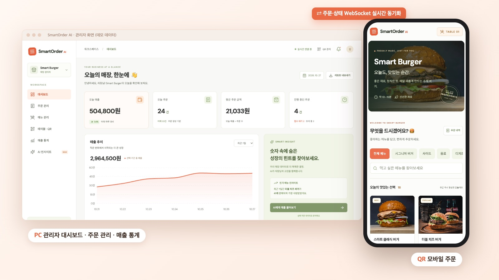
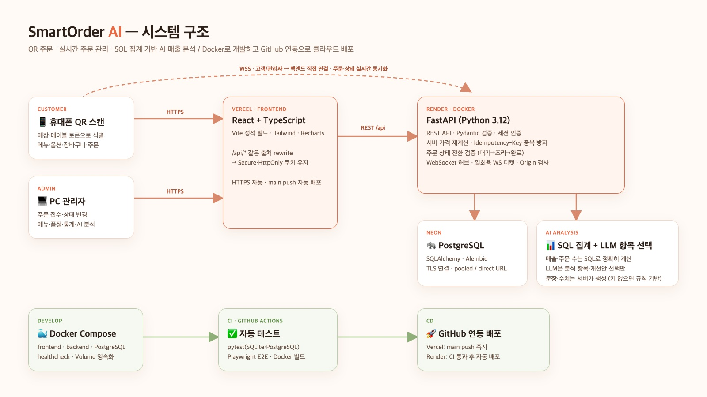
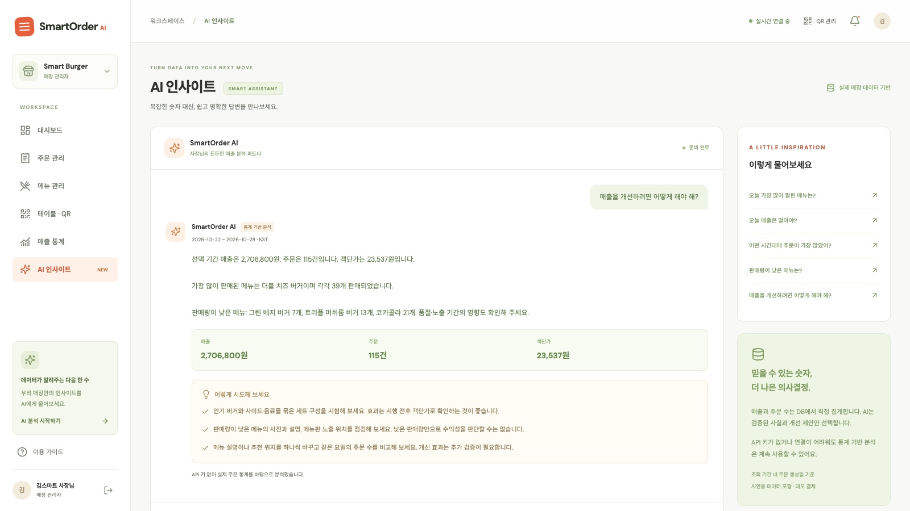

# SmartOrder AI

테이블의 QR코드를 스캔해 휴대폰으로 주문하고, 매장 관리자가 PC에서 주문을 실시간으로 관리하는 QR 주문 서비스입니다.

**라이브 서비스:** https://smartorder-ai-five.vercel.app



## 주요 기능

- **고객** — QR로 매장·테이블 식별, 카테고리별 메뉴, 옵션·수량 선택, 장바구니, 주문, 주문 상태 실시간 확인
- **관리자** — 신규 주문 실시간 알림, 접수 대기 → 조리 중 → 완료 상태 변경, 메뉴 등록·수정·삭제, 품절 관리, 테이블별 QR 생성
- **매출 통계** — 일별 매출·주문 수, 시간대별 주문, 인기 메뉴 순위, 매출 그래프, CSV 다운로드
- **AI 매출 분석** — 자연어 질문에 SQL로 집계한 실제 수치로 답변 (아래 참고)

결제는 데모용 시뮬레이션이며 실제 결제는 발생하지 않습니다.

## 기술 스택

| 영역 | 기술 |
|---|---|
| Frontend | React, TypeScript, Vite, Tailwind CSS, Recharts |
| Backend | Python 3.12, FastAPI, SQLAlchemy, Alembic, WebSocket |
| Database | PostgreSQL (로컬 개발은 SQLite도 지원) |
| AI | OpenAI API (Structured Outputs) |
| Infra | Docker Compose, GitHub Actions, Vercel, Render, Neon |

## 시스템 구조



- 주문 금액은 서버에서 다시 계산하고, 주문 당시 가격을 주문 항목에 저장합니다.
- `Idempotency-Key`로 같은 주문이 두 번 생성되지 않도록 막습니다.
- 주문 상태는 접수 대기 → 조리 중 → 완료 순서로만 바뀝니다.
- WebSocket은 "새 주문", "상태 변경" 신호만 보내고, 화면은 REST API로 최신 데이터를 다시 불러옵니다.

## AI 매출 분석



1. 매출·주문 수·메뉴 판매량·시간대별 주문을 **SQL로 집계**합니다.
2. LLM은 질문에 맞는 **분석 항목과 개선안을 정해진 목록에서 선택**만 합니다.
3. 답변의 수치와 문장은 **서버가 집계 결과로 생성**하므로 LLM이 수치를 지어낼 수 없습니다.
4. API 키가 없으면 키워드 규칙으로 같은 형식의 통계 기반 분석을 제공합니다.

## 로컬 실행 (Docker)

[Docker Desktop](https://docs.docker.com/desktop/setup/install/mac-install/) 또는 [Colima](https://github.com/abiosoft/colima)가 필요합니다.

```bash
python3 scripts/init-env.py          # 최초 1회: .env 생성
docker compose up --build            # frontend · backend · PostgreSQL 실행
docker compose exec backend python -m app.manage seed-demo   # 데모 데이터 (선택)
```

| 화면 | 주소 |
|---|---|
| 관리자 | http://localhost:5173/admin |
| 고객 주문 (데모) | http://localhost:5173/demo |
| API 문서 | http://localhost:8000/docs |

데모 관리자: `admin@smartburger.demo` / `SmartBurger!2026` — **로컬 데모 전용이며, 운영 환경에서는 차단됩니다.**

종료는 `docker compose down`입니다. DB 데이터는 Docker Volume에 유지됩니다.

<details>
<summary>Docker 없이 실행</summary>

```bash
./scripts/setup.sh   # Python 가상환경과 npm 패키지 설치
./scripts/dev.sh     # backend(8000) + frontend(5173) 실행
```

</details>

## 배포

| 구성 | 서비스 | 배포 방식 |
|---|---|---|
| Frontend | Vercel | `main` push 시 자동 배포 |
| Backend | Render (Docker) | GitHub Actions CI 통과 후 자동 배포 |
| Database | Neon (PostgreSQL) | — |

설정 방법은 [deploy/DEPLOYMENT.md](deploy/DEPLOYMENT.md)를 참고하세요.

## 테스트

```bash
cd backend && .venv/bin/python -m pytest -q        # API 테스트
cd frontend && npm run test:e2e                    # Playwright 브라우저 테스트
./scripts/test-compose.sh                          # Docker + PostgreSQL 통합 테스트
```

GitHub Actions에서 push마다 위 테스트와 Docker 빌드를 실행합니다.

## 프로젝트 구조

```text
backend/
  app/
    main.py        REST API, WebSocket
    models.py      DB 모델
    analytics.py   SQL 매출 집계
    ai.py          AI 분석
    manage.py      마이그레이션 · 데모 데이터 · 관리자 생성 명령
  alembic/         DB 마이그레이션
  tests/           API 테스트
frontend/
  src/             고객 화면(Customer), 관리자 화면(Admin, Orders, MenuManager, ...)
  e2e/             Playwright 테스트
deploy/            배포 가이드와 환경변수 예시
scripts/           실행 · 테스트 · 배포 보조 스크립트
compose.yaml       Docker Compose
render.yaml        Render 설정
```
