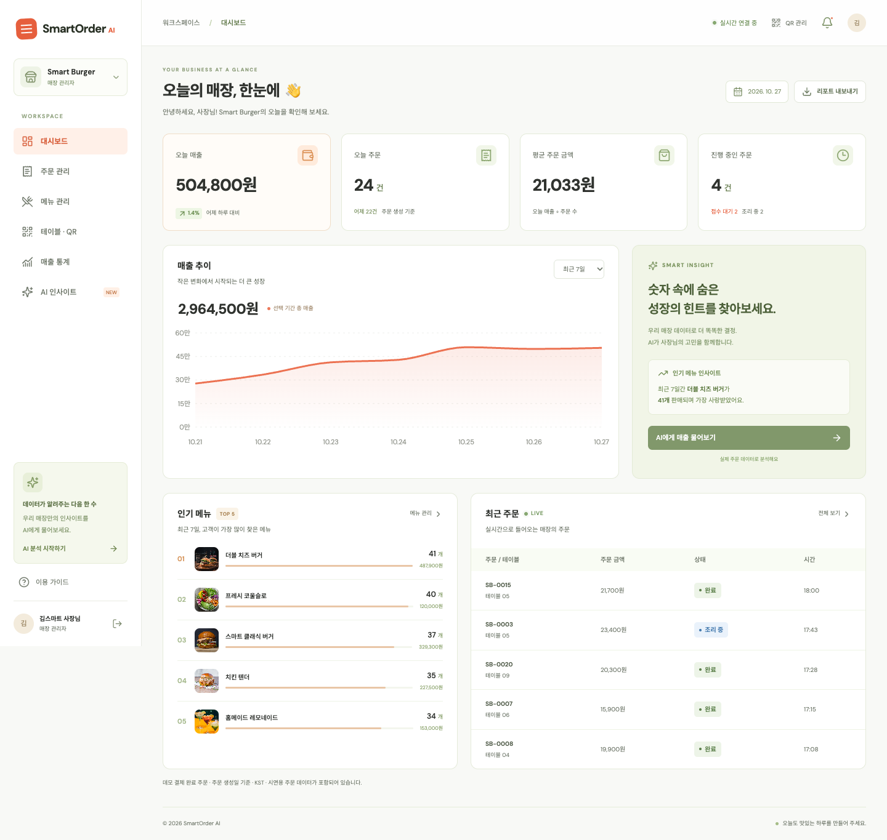
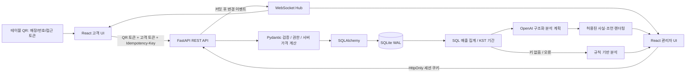
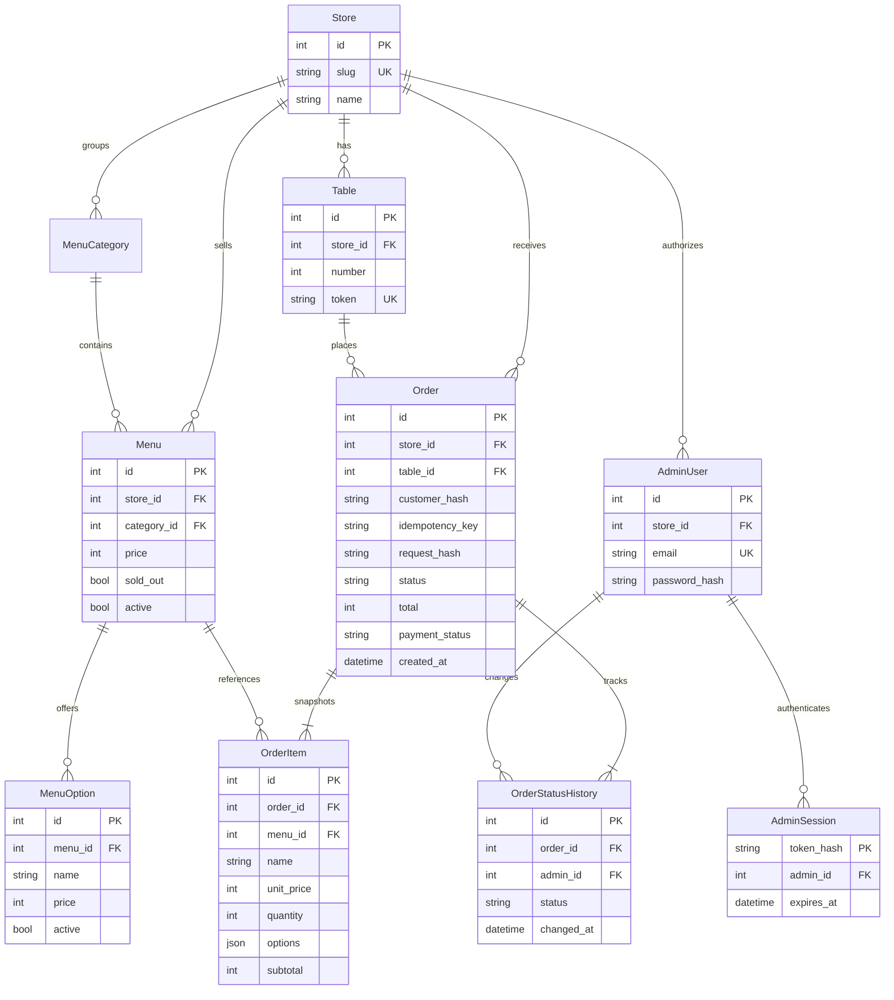

# SmartOrder AI

**QR로 주문하고, 실시간으로 준비하고, 데이터로 매장을 이해합니다.**

React + FastAPI 기반의 실제 동작하는 QR 주문 플랫폼 포트폴리오 MVP입니다. 고객용 모바일 주문, 관리자 주문·메뉴 관리, SQL 기반 매출 통계, OpenAI 선택형 분석을 제공합니다. 결제는 데모 시뮬레이션이며 실제 청구는 발생하지 않습니다.



## Docker / Vercel · Render · Neon 배포

Docker 개발 환경과 PostgreSQL/Alembic, 클라우드 배포 구성을 추가했습니다. **[배포 가이드](deploy/DEPLOYMENT.md)**와 **[이번 검증 기록](artifacts/deployment-verification.md)**을 먼저 확인하세요. Docker Desktop 설치, 계정 연결, 실제 배포 승인 상태는 검증 기록에 구분했습니다.

```bash
# Docker Desktop 실행 후, 최초 환경 준비 (기존 .env는 보존)
python3 scripts/init-env.py
docker compose up --build
# 로컬 샘플이 필요할 때만 별도 실행
docker compose exec backend python -m app.manage seed-demo

# 백그라운드 실행 / 상태·로그 확인
docker compose up --build -d
docker compose ps          # db·backend·frontend 모두 healthy 인지 확인
docker compose logs -f backend

# 중지 (PostgreSQL 데이터 Volume은 유지)
docker compose down
```

접속: 고객/관리자 http://localhost:5173 (관리자 `/admin`, 데모 고객 `/demo`), API 문서 http://localhost:8000/docs, readiness http://localhost:8000/api/ready. 통합 검증은 `./scripts/test-compose.sh`.

`docker compose down -v`는 DB Volume까지 **삭제**하므로 데이터를 지우려는 경우에만 사용하세요.

서버 시작 시 샘플 데이터는 **더 이상 자동 생성하지 않습니다**. 기존 SQLite는 보존하고 Docker PostgreSQL은 별도 Volume을 사용합니다. 클라우드에서는 공개 데모 계정 대신 `python -m app.manage bootstrap`으로 관리자를 생성합니다. GitHub push·공개 배포·유료 리소스 생성 전 사용자 승인이 필요합니다.

## 빠르게 실행하기

요구 환경: **Python 3.11+ (검증: 3.12), Node.js 20.19+ 또는 22 LTS (검증: 22), npm**, macOS/VS Code. 이 작업 환경에는 프로젝트 내부 `.tools/`에 격리된 Node.js 22와 Python 3.12가 준비되어 있습니다. 전역 설치나 기존 시스템 Python 변경은 하지 않았습니다. `.tools/`와 `.venv/`는 저장소에 포함하지 않습니다.

```bash
# 프로젝트 루트에서
./scripts/setup.sh
./scripts/dev.sh
```

새 네이티브 DB는 `cd backend && .venv/bin/python -m app.manage migrate` 후 필요할 때만 `seed-demo`를 실행합니다. 이전 `create_all` DB는 백업 후 `adopt-legacy`로 편입하세요. 현재 작업 폴더의 기존 DB는 데이터를 보존한 채 편입했습니다.

현재 작업 폴더는 의존성이 설치되어 있으므로 `./scripts/dev.sh`만으로 시작할 수 있습니다. 종료는 `Ctrl+C`입니다. `setup.sh`는 기존 `.env`를 덮어쓰지 않습니다. 포트 8000, 5173이 사용 중이라면 기존 서버를 종료하거나 설정을 변경하세요.

### 백엔드만 실행

```bash
cd backend
python3.12 -m venv .venv         # 새 체크아웃에서 최초 1회
source .venv/bin/activate
pip install -r requirements.lock.txt
cp .env.example .env            # 최초 1회, 기존 설정은 보존
python -m app.manage migrate
# 새 로컬 데모 DB에 한해서 선택: python -m app.manage seed-demo
uvicorn app.main:app --reload --host 127.0.0.1 --port 8000
```

이미 이 환경에 설치된 가상환경은 `backend/.venv/bin/python`입니다. 전역 `python3`는 3.9이므로 새 가상환경을 만들 때 주의하세요.

### 프론트엔드만 실행

```bash
# 이 환경에서만 필요: 시스템 PATH에 Node.js가 없을 경우
export PATH="$PWD/.tools/node/bin:$PATH"
cd frontend
npm ci
npm run dev
```

| 화면 | 접속 주소 |
|---|---|
| 관리자 로그인 / 대시보드 | http://localhost:5173/admin |
| 주문 관리 | http://localhost:5173/admin/orders |
| 메뉴 관리 | http://localhost:5173/admin/menus |
| 테이블 QR | http://localhost:5173/admin/tables |
| 매출 통계 | http://localhost:5173/admin/analytics |
| AI 인사이트 | http://localhost:5173/admin/ai |
| 고객 데모 바로가기 | http://localhost:5173/demo |
| 고객 주문 | `http://localhost:5173/order/smart-burger/1?token=<테이블 QR 토큰>` |
| API 문서 (Swagger) | http://127.0.0.1:8000/docs |
| 헬스체크 | http://127.0.0.1:8000/api/health |

**고객 화면은 로그인 페이지의 “고객 주문 화면 체험하기” 또는 관리자 → 테이블 · QR → “주문 화면”으로 바로 여세요.** QR 토큰은 DB 최초 생성 때 무작위로 생성됩니다. `/api/demo`는 ENABLE_DEMO_LINK가 켜진 로컬 데모 모드에서 테이블 1의 실제 접속 주소를 반환합니다. 토큰 없는 테이블 번호만으로는 접근할 수 없습니다.

### 데모 관리자

- 이메일: **admin@smartburger.demo**
- 비밀번호: **SmartBurger!2026**
- 로그인 화면의 “데모 계정으로 둘러보기”는 입력란을 채웁니다. 이어서 “관리자 로그인”을 누르세요.
- **공개된 데모 비밀번호를 운영 환경에 그대로 배포하지 마세요.** 실제 운영에는 새 DB, 별도의 관리자 계정 생성, HTTPS, `SEED_DEMO=false`, `COOKIE_SECURE=true`, `APP_ENV=production`이 필요합니다. 운영 모드에서 데모 시딩이나 안전하지 않은 쿠키가 설정되어 있으면 서버가 시작되지 않습니다.

## QR 테스트: 핵심 시연 흐름

1. 관리자에 로그인하고 **테이블 · QR**에서 테이블 1의 주문 화면을 새 탭으로 엽니다.
2. 고객 화면에서 버거 선택 → 치즈 옵션 → 수량 선택 → 장바구니 → 요청사항 → 주문하기.
3. 금액은 서버에서 재계산하고 `demo_paid`로 저장합니다. 고객에게 주문 번호와 접수 대기 상태가 표시됩니다.
4. 관리자 화면에 **실시간 신규 주문 알림**이 뜹니다. 주문 관리에서 해당 주문을 접수하면 `조리 중`이 됩니다.
5. 조리 완료를 누르면 고객의 주문 상세가 **완료**로 바뀝니다. 새로고침할 필요가 없습니다.
6. AI 인사이트에서 오늘 매출이나 인기 메뉴를 질문합니다. API 키 없이도 동작합니다.

QR PNG 다운로드와 인쇄도 지원합니다. 인쇄 시 사이드바·조작 버튼을 숨기고 QR 카드를 출력합니다.

### 실제 휴대폰에서 테스트

컴퓨터와 휴대폰을 같은 Wi-Fi에 연결하세요. `localhost`는 휴대폰 자신을 가리키므로 LAN IP로 설정해야 합니다.

```dotenv
# backend/.env 예시. 192.168.0.10을 실제 Mac IP로 교체
FRONTEND_URL=http://192.168.0.10:5173
ALLOWED_ORIGINS=["http://localhost:5173","http://127.0.0.1:5173","http://192.168.0.10:5173"]
```

백엔드를 재시작하고 프론트엔드는 `npm run dev`(0.0.0.0 바인딩)로 실행한 뒤, QR을 다시 다운로드하세요. API·WebSocket은 Vite 프록시를 통해 전달되어 백엔드는 127.0.0.1에 둘 수 있습니다. macOS 방화벽에서 로컬 네트워크 접속이 허용되어야 합니다. 신뢰할 수 있는 로컬 네트워크에서만 개발 서버를 사용하세요.

## 프로젝트 구조

```text
AI_order/
├── backend/
│   ├── app/
│   │   ├── main.py          # REST 라우트, 권한 검사, WebSocket Hub
│   │   ├── models.py        # SQLAlchemy 모델 · 관계 · DB 제약
│   │   ├── schemas.py       # Pydantic 요청 검증
│   │   ├── db.py            # DB 세션, SQLite WAL/외래키
│   │   ├── config.py        # .env 설정, 운영 모드 가드
│   │   ├── security.py      # Argon2, 세션 인증, rate limiter
│   │   ├── analytics.py     # KST 기준 SQL 집계
│   │   ├── ai.py            # OpenAI 구조화 응답 + 통계 fallback
│   │   └── seed.py          # 매장·테이블·메뉴·주문 데모 데이터
│   ├── tests/              # API · 동시성 · 인증 · WebSocket 테스트
│   ├── .env.example
│   ├── requirements.txt    # 지원 버전 범위
│   └── requirements.lock.txt # 검증한 의존성 버전
├── frontend/
│   ├── src/
│   │   ├── Customer.tsx    # 메뉴 · 옵션 · 장바구니 · 주문 내역
│   │   ├── Admin.tsx       # 로그인 · 관리자 레이아웃
│   │   ├── Dashboard.tsx   # 통계 카드 · Recharts · CSV
│   │   ├── Orders.tsx      # 주문 접수 · 상태 · 이력 · 테이블 필터
│   │   ├── MenuManager.tsx # 메뉴 CRUD · 품절 · 옵션
│   │   ├── Tables.tsx      # QR 조회 · 다운로드 · 인쇄
│   │   ├── Analysis.tsx    # AI 질의 인터페이스
│   │   ├── api.ts          # API 클라이언트 · WebSocket 복구
│   │   ├── types.ts        # 공유 TypeScript 타입
│   │   ├── ui.tsx          # 모달 · 알림 · 로딩 · 공통 컴포넌트
│   │   └── styles.css      # Tailwind + 반응형 디자인
│   ├── public/images/     # 로컬 데모 음식 사진
│   ├── e2e/               # Playwright 브라우저 테스트
│   └── playwright.config.ts
├── scripts/               # setup.sh, dev.sh, test.sh, 이미지 다운로드
├── artifacts/             # 실제 브라우저 캡처와 검증 기록
└── README.md
```

## 구현한 기능

- **고객:** QR 매장·테이블 인증, 카테고리·검색, 메뉴 사진·설명·배지, 옵션·수량, 장바구니 저장·삭제, 요청사항, 주문 생성, 데모 결제, 주문 완료·처리 이력, 브라우저별 주문 조회.
- **관리자:** 쿠키 로그인·로그아웃, 실시간 신규 주문 알림, 상태 전환, 주문 상세·검색·테이블 필터, 이전 주문 더 보기, 메뉴 등록·수정·논리 삭제, 옵션 관리, 품절 전환.
- **통계:** 오늘 매출·주문·객단가, 7/14/30일 그래프, 전일 대비, 시간대별 주문, 인기 메뉴 TOP 5, CSV 다운로드.
- **AI:** 오늘/최근 7일 실제 DB 데이터, 자연어 질문, 검증된 사실 설명, 개선 아이디어, API 키 미설정·오류·타임아웃 fallback.
- **QR:** 테이블 10개별 접근 토큰, PNG 생성·다운로드·인쇄, 고객 화면 링크.
- **UX:** 모바일 고객 화면, 데스크톱 사이드바, 모바일 관리자 내비게이션, 모달 포커스 트랩·ESC·포커스 복귀, 라벨·키보드 포커스, 로딩·오류·빈 화면·품절 표시, reduced-motion 대응.

## 시스템 아키텍처



프론트엔드는 API의 단일 출처 프록시를 사용합니다. 개발 시 Vite가 `/api`, `/ws`를 FastAPI로 전달합니다. 배포 시에는 빌드된 `dist/`를 정적 호스팅하고 동일 도메인 리버스 프록시에서 `/api`, `/ws`를 FastAPI로 연결해야 합니다. `vite preview`만 실행해서는 프록시 포함 운영 구성이 완성되지 않습니다.

### 주문의 신뢰 경계

- 클라이언트의 가격·합계 필드는 받지 않습니다(`extra='forbid'`). 메뉴와 옵션의 매장 소속·활성·품절 상태를 확인한 뒤 원 단위 정수로 계산합니다.
- `OrderItem`에 메뉴명, 옵션명·옵션가격, 옵션 포함 단가, 수량, 소계를 스냅샷으로 저장합니다. 이후 메뉴 가격 변경·삭제가 과거 주문과 매출을 변경하지 않습니다.
- `(store_id, idempotency_key)` DB 고유 제약으로 동시 중복 주문도 방지합니다. 키 재사용 시 테이블·고객·payload의 해시가 동일하면 기존 응답, 다르면 409입니다. 프론트엔드가 같은 요청의 키를 로컬 저장해 네트워크 실패 후 재시도에 재사용합니다.
- 주문과 항목·최초 상태 이력은 한 트랜잭션으로 커밋합니다.
- 상태 변경은 `UPDATE ... WHERE status=expected`의 영향 행 수로 경쟁을 검증하고, 성공한 상태와 이력을 함께 커밋합니다.
- 테이블 QR은 주문할 수 있는 능력을 부여하는 토큰입니다. 개인 주문 내역은 별도의 브라우저 고객 토큰 해시로 구분하여 같은 테이블의 다른 손님에게 노출하지 않습니다.

### 실시간 전달

서버 커밋 후 WebSocket으로 `order.created`, `orders.changed`, `menu.changed` 이벤트를 보냅니다. 이벤트는 변경 사실만 포함하고 상세 데이터는 인증된 REST API에서 다시 읽습니다. 관리자는 동일 출처 REST에서 발급한 30초 일회용 WebSocket 티켓(로컬 기존 쿠키 방식도 호환), 고객은 최초 메시지의 QR 토큰으로 인증합니다. URL 쿼리에 관리자 세션 토큰을 싣지 않습니다. Origin 확인, 5초 인증 제한, heartbeat, 만료·로그아웃 세션 확인, 연결 종료 정리를 포함합니다. 클라이언트는 3초 후 재연결하고 15초 간격 조회로 유실·연결 장애를 보완합니다.

## ERD



DB는 UTC 시각을 저장하고 통계는 `Asia/Seoul` 날짜 경계로 조회합니다. SQLAlchemy Session 경계와 타입을 분리해 PostgreSQL 전환을 고려했습니다. `psycopg` 드라이버와 `DATABASE_URL=postgresql+psycopg://...`, Alembic 마이그레이션과 PostgreSQL CI 테스트를 추가했습니다. 실제 실행 여부는 최신 배포 검증 기록을 참고하세요. Docker/PostgreSQL 실제 실행과 클라우드 배포는 별도의 검증 단계입니다.

## 주요 REST API

`{scope}` = `/api/stores/{slug}/tables/{number}`. 고객 API에는 `X-Table-Token`, 주문 조회·생성에는 추가로 `X-Customer-Token`이 필요합니다. 관리자 API는 HttpOnly 세션 쿠키를 요구합니다.

| Method | Endpoint | 용도 |
|---|---|---|
| GET | `/api/health` | 서버 확인 |
| GET | `/api/demo` | 데모 테이블 주소 (SEED_DEMO 전용) |
| GET | `{scope}/menu` | 매장·테이블·카테고리·메뉴 |
| POST | `{scope}/orders` | 주문 생성, `Idempotency-Key` 필수 |
| GET | `{scope}/orders` | 해당 고객·테이블의 주문 |
| POST | `/api/auth/login` | 세션 생성 (8시간) |
| GET | `/api/auth/me` | 인증·관리자 정보 |
| POST | `/api/auth/logout` | 서버 세션 폐기·쿠키 제거 |
| GET | `/api/admin/orders` | 주문 조회, `table_number`, `limit`, `offset` |
| PATCH | `/api/admin/orders/{id}/status` | cooking / completed |
| GET, POST | `/api/admin/menus` | 메뉴 목록 / 등록 |
| PUT, DELETE | `/api/admin/menus/{id}` | 수정 / 논리 삭제 |
| PATCH | `/api/admin/menus/{id}/availability` | 품절 전환 |
| GET | `/api/admin/stats?days=7` | 매출·일별·시간별·메뉴 집계 |
| POST | `/api/admin/analysis` | `{question, days: 1 또는 7}` |
| GET | `/api/admin/tables` | 테이블별 QR 링크 |
| GET | `/api/admin/tables/{id}/qr` | 인증된 PNG 응답 |
| WS | `/ws` | 관리자 또는 고객 실시간 이벤트 |

주문 body 예:

```json
{"items":[{"menu_id":1,"quantity":2,"option_ids":[1]}],"note":"양파 빼 주세요"}
```

주요 오류: 400 유효하지 않은 메뉴·옵션·고객 세션, 401 관리자 인증 필요, 403 QR/Origin 오류, 404 다른 매장 또는 없는 리소스, 409 품절·키 충돌·잘못된 상태 전환, 422 요청 검증 실패, 429 요청 제한. 관리자 리소스는 모든 요청에서 매장 소속을 검사합니다.

## AI의 동작과 정확성

`backend/.env`에만 키를 저장합니다. 프론트엔드 코드나 `VITE_` 변수에 키를 넣지 마세요.

```dotenv
OPENAI_API_KEY=여기에_본인_API_키
OPENAI_MODEL=gpt-4.1-mini
```

1. 서버가 선택 기간을 KST 기준으로 계산합니다. 화면의 **분석 기간 선택**이 질문 속 상대 날짜보다 우선합니다.
2. SQL의 `SUM`, `COUNT`, `GROUP BY`, 외부 조인으로 매출·주문 수·객단가·메뉴 판매량·시간대별 주문을 계산합니다. 판매가 없는 메뉴도 순위 데이터에 0으로 포함합니다.
3. OpenAI Responses API와 Pydantic Structured Outputs를 이용해 `focus`(매출/인기/시간대/저판매)와 `suggestions`(세트/사전준비/노출개선/실험) 열거형을 선택합니다. 질문과 메뉴명은 신뢰하지 않는 입력으로 취급합니다.
4. **사실 문장과 모든 숫자는 서버가 집계 데이터로 생성합니다.** LLM의 임의 매출 숫자나 자유 형식 사실 주장을 UI에 직접 표시하지 않습니다. 개선 제안도 검토한 문구 집합에서 선택하므로 판매 효과를 보장하는 허구의 수치를 만들지 않습니다.
5. 모델이 선택한 관점에 맞춰 한국어 설명과 SQL 근거 수치를 함께 반환합니다. `store=False`, 타임아웃·제한된 재시도, 요청 제한을 적용했습니다.
6. API 키 없음, 연결 오류, 거부·비정상 응답은 규칙 기반 분석으로 대체하고 사용자가 모드를 알 수 있도록 표시합니다. 주문과 관리자 기능은 AI와 독립적입니다.

이 MVP는 **제약된 생성형 분석**입니다. 표현 자유도보다 숫자 무결성을 우선했습니다. 임의 SQL 생성, LLM의 자유 형식 사업 조언, 복잡한 다중 대화 추론은 지원하지 않습니다. 알 수 없는 질문은 선택 기간의 기본 매출 요약을 제공합니다. 메뉴 이름을 포함한 집계 데이터가 API 활성화 시 OpenAI로 전달되며, 고객 요청사항과 세션 토큰은 보내지 않습니다.

구현 기준: [OpenAI 공식 Structured Outputs 문서](https://developers.openai.com/api/docs/guides/structured-outputs). 실제 유료 API 호출은 키 미설정으로 실행하지 않았으며, 성공·타임아웃 분기는 모의 클라이언트로 검증했습니다.

## 샘플 데이터

`python -m app.manage seed-demo`를 명시적으로 실행할 때만 생성됩니다. 기존 매장이 있으면 아무 데이터도 변경하지 않으며 운영 모드에서는 거부합니다.

- Smart Burger / 테이블 10개 / 카테고리 4개
- 버거 6종, 사이드 5종, 음료 4종, 디저트 1종: **메뉴 16개**
- 버거별 추가 옵션 3개
- 최근 7일 주문 **126건**, 접수 대기·조리 중 각 2건 포함
- SQL 계산으로 생성한 메뉴별 주문 합계와 상태 이력
- 데모 관리자 1명, Argon2 비밀번호 해시

날짜는 DB 최초 생성 당시를 기준으로 하므로 여러 날 뒤 다시 실행하면 오늘 데이터가 비어 있을 수 있습니다. 이는 실제 조회 결과입니다. 새 시연용 DB가 필요하면 **기존 DB를 삭제하지 말고** `DATABASE_URL=sqlite:///./new-demo.db`로 별도의 파일을 지정하세요.

사진은 Unsplash 데모 음식 사진을 로컬에 저장했습니다. `scripts/download_images.py`에 원본 photo ID를 기록했습니다. 일부 메뉴는 같은 이미지를 공유하고 실제 조리 내용과 차이가 있을 수 있습니다. 상용 매장 사용 시 실제 메뉴 사진·원산지·알레르기 정보로 교체하세요. Google Fonts는 네트워크가 없으면 시스템 글꼴로 대체됩니다.

## 초기 MVP 실행·테스트 결과

아래는 최초 구현 당시 기록입니다. Docker/클라우드 변경 이후 결과는 [최신 검증 기록](artifacts/deployment-verification.md)을 확인하세요.

```bash
./scripts/test.sh
# 또는
cd backend && .venv/bin/python -m pytest -q
cd ../frontend && npm run build && npm run test:e2e
```

macOS E2E는 설치된 Google Chrome을 사용합니다. 다른 OS에서는 `npx playwright install chromium`이 필요합니다. E2E가 테스트 전용 8001/5174 서버와 OS 임시 디렉터리의 고유 SQLite DB를 생성하므로 일반 데모 DB를 변경하지 않습니다. 테스트 후 서버는 종료되며 임시 DB는 OS 정리 대상입니다.

| 검증 | 결과 |
|---|---|
| pytest API·DB·WebSocket | **23개 통과** |
| Playwright Chrome E2E | **5개 통과** |
| TypeScript 엄격 타입 검사 | 통과 |
| Vite 프로덕션 빌드 | 통과 |
| npm 의존성 감사 (설치 시) | 알려진 취약점 0개 |
| 실제 OpenAI 유료 호출 | 미실행 — API 키 없음 |
| 실제 휴대폰 카메라 스캔 | 미실행 — QR PNG·URL·모바일 브라우저 검증 |

API 테스트: 동시 중복 생성, 키 충돌, 옵션 소속·중복, 잘못된 수량·가격 조작, 가격 스냅샷, 품절, 고객 분리, 매장 권한, Argon2, 세션 만료·로그아웃, Origin, 상태 경쟁 방지, SQL 합계 일치, QR PNG, AI 성공/오류 mock, WebSocket 인증·이벤트·로그아웃.

브라우저 테스트: 390px 고객 화면의 메뉴 옵션→주문→관리자 접수→조리 완료→고객 실시간 상태, 메뉴 CRUD·품절 동기화, 차트·CSV·AI fallback, QR 10개, 장바구니 삭제, 잘못된 QR, 비인증 접근, 모바일 관리자 메뉴, 가로 스크롤·브라우저 JS 오류 검사. 전체 화면 캡처는 [artifacts](artifacts/)에서 확인할 수 있습니다.

## 보안·운영 범위와 제한

- 비밀번호 Argon2 해시, 서버에 SHA-256 해시로 보관하는 고엔트로피 세션 토큰, HttpOnly/SameSite 쿠키, 세션 만료·로그아웃 폐기.
- QR·고객 토큰, Origin allowlist, 관리자 매장 권한, 요청 크기·수량 검증, 로그인·주문·AI 요청 제한.
- SQLite 외래키·WAL·고유 제약, 원화 정수 금액, 소프트 삭제, 가격 스냅샷, 상태 이력.
- **단일 프로세스/단일 워커 MVP**입니다. WebSocket 구독과 rate limiter는 메모리 기반입니다. 다중 워커에는 Redis Pub/Sub·공유 제한 저장소·이벤트 outbox가 필요합니다. AI 호출 중 일부 동기 DB 작업이 이벤트 루프를 짧게 점유하므로 고부하 성능 검증·분리가 필요합니다.
- DB 스키마는 Alembic 마이그레이션으로 관리합니다. 기존 스키마 편입과 추가 테이블을 검증했으며 운영 데이터 백업·복구 절차는 별도입니다.
- 실제 PG 결제·환불·취소, 재고 수량 차감, POS/프린터, 관리자 가입·비밀번호 재설정·권한 역할, 다중 매장 전환 UI, 카테고리 CRUD, 파일 업로드는 범위 밖입니다. 이미지 URL 등록은 지원합니다.
- 알레르기·원산지 안내는 직원 문의용 문구만 포함했습니다. 실제 서비스에는 검증된 매장별 정보가 필요합니다.
- QR 토큰의 소유자는 원격에서도 주문할 수 있습니다. 매장 방문 인증·일회용 테이블 세션·토큰 회전은 후속 개선 과제입니다. 고객 브라우저 저장소를 삭제하면 과거 주문 조회 자격도 없어집니다.
- 관리자 목록 UI는 최근 최대 200건까지, 고객은 최근 100건까지 표시합니다. REST 관리자 목록은 offset 페이지 조회를 제공합니다. AI 분석 기간은 오늘/7일입니다.
- 사진은 데모 자료이며 실제 메뉴를 보증하지 않습니다. 결제는 전부 시뮬레이션입니다. 이 결과물은 포트폴리오 MVP이며 운영 배포 심사·실부하·장애 복구 검증을 마친 제품은 아닙니다.

## 면접에서 설명할 포인트

**왜 서버 재계산과 스냅샷인가?** 클라이언트 금액은 조작될 수 있고 메뉴 가격은 변경됩니다. 주문 시 서버 금액을 확정하고 항목에 기록하면 결제·통계의 역사적 일관성을 유지할 수 있습니다.

**왜 idempotency를 DB에서 보장하는가?** 버튼 비활성화만으로는 네트워크 재시도나 여러 탭·동시 요청을 막을 수 없습니다. DB 고유 제약을 최종 방어선으로 삼고 동일 요청에는 동일 응답을 제공합니다.

**왜 WebSocket에 주문 데이터를 모두 싣지 않았는가?** 인증된 REST API를 단일 데이터 조회 경로로 유지하면서 push는 변경 알림에만 사용했습니다. 재연결 시 REST 재조회로 복구가 쉽고 이벤트 자체의 데이터 노출도 줄어듭니다.

**왜 AI가 SQL을 작성하거나 매출을 계산하지 않는가?** 수치는 관계형 DB가 정확히 계산하도록 하고 AI의 역할을 해석 방향과 개선 제안 선택으로 제한했습니다. 구조화된 허용 목록과 서버 렌더링은 프롬프트의 “환각 금지” 문구보다 강한 제한을 만듭니다.

**SQLite에서 확장하려면?** ORM·서비스 경계를 유지하면서 PostgreSQL과 마이그레이션을 도입하고, WebSocket/요청 제한을 Redis로 분리합니다. 커밋 후 이벤트 유실은 outbox·소비자 재처리로 보강합니다. 이 MVP는 주기적 REST 재조회로 복구합니다.

### Codex 활용 개발 과정

1. 빈 작업 폴더와 시스템 런타임을 점검했습니다. Python 3.9/Node 부재를 확인하고 프로젝트 내부에 Python 3.12·Node 22를 격리 설치했습니다.
2. QR 주문→관리자 접수→실시간 변경을 핵심 흐름으로 잡고 모델, 검증, 인증, 서버 가격 계산, 중복 방지, 데모 시드를 구현했습니다.
3. 고객 화면과 관리자 화면을 나누고 화이트·코랄 디자인, 매출 차트, 메뉴 편집, QR 관리, 제약된 AI 분석을 연결했습니다.
4. OpenAI 공식 문서를 확인한 뒤 Structured Outputs를 적용하고 API 키가 없는 경우도 완전한 사용자 흐름을 유지했습니다.
5. API 테스트와 실제 Chrome의 독립된 고객/관리자 컨텍스트로 기능을 검증했습니다. 실패한 이미지 URL, 실행 경로 문제, 캡처 시 차트 애니메이션, 모바일 가독성을 수정했습니다.
6. 실제 캡처, 실행 스크립트, 의존성 잠금, 시스템 아키텍처·ERD·API·제한사항을 남겼습니다. 구현과 검증이 끝난 범위 및 실제 외부 API 미검증 범위를 구분했습니다.

AI가 코드를 작성한 것 자체보다 **신뢰 경계·일관성·검증 가능한 증거·명시적인 운영 한계**를 설명하는 데 초점을 맞춘 프로젝트입니다.
