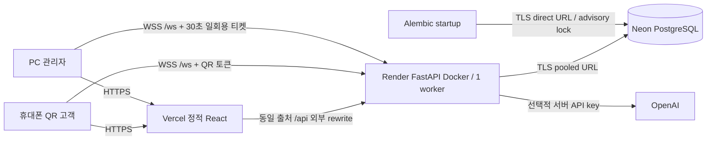

# SmartOrder AI — Docker 및 클라우드 배포

이 문서는 **구성 완료**와 **실제 실행·배포 완료**를 구분합니다. 현재 실행 증거는 `artifacts/deployment-verification.md`에 있습니다. 클라우드 리소스 생성·GitHub push·공개 배포는 사용자 승인 후 수행합니다. 자동 배포는 기본적으로 비활성화되어 있습니다.

## 1. 기존 구조와 변경점

- React 19 / TypeScript / Vite / Tailwind / Recharts, Python 3.12 / FastAPI / SQLAlchemy는 유지했습니다.
- 기존 DB는 SQLite였습니다. 로컬 네이티브 개발은 SQLite를 유지할 수 있고, Docker와 클라우드는 PostgreSQL을 사용합니다.
- `postgresql://`, `postgres://` 형식도 자동으로 psycopg 3 드라이버에 연결합니다.
- 기존 데이터 내보내기는 **CSV**이며 `.xlsx` Excel 생성 기능은 없습니다. CSV 다운로드를 유지했습니다.
- 시작 시 `create_all`과 샘플 데이터 자동 생성을 제거했습니다. 스키마는 Alembic, 샘플은 명시적 CLI 명령으로 관리합니다.
- `0001`: 기존 모델의 고정된 스키마 스냅샷. `0002`: 일회용 WebSocket 인증 티켓.
- 기존 SQLite DB는 삭제하지 않았습니다. 사전 백업 후 Alembic으로 편입하고 새 테이블만 추가했습니다. 기존 주문 126건 / 합계 2,964,500원을 보존했습니다.

## 2. 로컬 Docker (Apple Silicon M2)

### 필요한 프로그램

[Docker Desktop for Mac 공식 설치 페이지](https://docs.docker.com/desktop/setup/install/mac-install/)에서 **Apple Silicon** 버전을 설치합니다. Docker.app을 실행하고 초기 설정을 마친 뒤 엔진이 준비될 때까지 기다리세요.

```bash
docker version
docker compose version
docker info
```

`docker version`에 Client뿐 아니라 Server 정보가 있어야 합니다. 명령을 찾지 못하면 Docker Desktop의 CLI 설치 설정을 확인하거나 `export PATH="/Applications/Docker.app/Contents/Resources/bin:$PATH"`를 적용하세요. Homebrew를 사용하는 경우 `brew install --cask docker`로 설치할 수도 있습니다. 이 프로젝트 작업에서는 Docker Desktop 앱 설치·OS 초기 설정을 자동 수행하지 않았습니다.

### 실행

```bash
# 최초 환경 준비. 실제 비밀번호는 무작위 생성하며 출력하지 않습니다.
python3 scripts/init-env.py

# 이후 전체 서비스 실행은 이 명령 하나입니다.
docker compose up --build
```

현재 작업 폴더에는 `init-env.py`로 생성한 Git 제외 `.env`가 준비되어 있습니다. 기존 `.env`가 있으면 스크립트는 덮어쓰지 않습니다.

| 서비스 | 동작 |
|---|---|
| frontend | Node 22, Vite 개발 서버, 소스 bind mount, polling Hot Reload |
| backend | Python 3.12, 비루트 사용자, PostgreSQL 준비 후 Alembic → Uvicorn reload |
| db | PostgreSQL 17, `postgres_data` Docker Volume, 내부 네트워크만 노출 |

Apple Silicon은 각 공식 이미지의 ARM64를 사용합니다. `platform: linux/amd64`를 강제하지 않습니다. Render는 동일 Dockerfile을 해당 플랫폼에서 빌드합니다. PostgreSQL은 호스트 포트를 열지 않습니다. 기본 API·웹 포트는 호스트 127.0.0.1에만 노출됩니다.

- 관리자: http://localhost:5173/admin
- 데모 고객: http://localhost:5173/demo (**명시적 샘플 생성 후**)
- API 문서: http://localhost:8000/docs
- liveness: http://localhost:8000/api/health
- readiness (DB 및 스키마 확인): http://localhost:8000/api/ready

### 초기 데이터: 둘 중 하나를 선택

**로컬 데모** — 샘플 매장·메뉴·주문·공개 데모 비밀번호를 생성하는 명시적 명령입니다.

```bash
docker compose exec backend python -m app.manage seed-demo
```

기존 매장이 하나라도 있으면 아무 데이터도 변경하지 않습니다. `APP_ENV=production`에서는 실행이 거부됩니다. `ENABLE_DEMO_LINK=true`는 데모 URL을 켜는 옵션일 뿐, 데이터를 생성하지 않습니다. 기존 `SEED_DEMO`도 더 이상 시딩을 수행하지 않습니다.

**실제 매장용 빈 시작** — 새로운 관리자 비밀번호를 화면에 표시하지 않고 대화형으로 입력합니다.

```bash
docker compose exec backend python -m app.manage bootstrap --slug smart-burger --name 'Smart Burger'
```

16자 이상의 고유 비밀번호를 요구하고 기존 계정·매장을 덮어쓰지 않습니다. 매장, 관리자, 테이블 10개, 카테고리만 생성합니다. 로그인 후 메뉴를 등록하세요. 기존 데모 DB를 운영 DB로 재사용하지 마세요.

### 보존·종료·백업

```bash
docker compose down  # PostgreSQL Volume은 남습니다.
# 백업 파일은 Git 제외 대상입니다. 출력 내용을 채팅이나 로그에 붙이지 마세요.
docker compose exec -T db pg_dump -U smartorder -d smartorder -Fc > smartorder.backup
```

`docker compose down -v`, `docker volume rm`, 운영 `drop_all`, DB 삭제를 실행하지 않았습니다. 데이터 삭제가 필요하면 별도의 명시적 승인과 백업이 필요합니다. `.env`의 PostgreSQL 비밀번호를 변경해도 이미 생성된 DB 사용자의 비밀번호가 자동 변경되지는 않습니다. 기존 Volume의 계정은 SQL 관리자 절차로 변경해야 합니다.

### 같은 Wi-Fi 휴대폰 테스트

루트 `.env`의 다음 값을 실제 Mac IP에 맞춥니다.

```dotenv
FRONTEND_BIND=0.0.0.0
FRONTEND_URL=http://192.168.0.10:5173
ALLOWED_ORIGINS=["http://localhost:5173","http://127.0.0.1:5173","http://192.168.0.10:5173"]
```

`docker compose up -d`로 재생성하고 관리자 QR 화면에서 **새 주소로 QR을 다시 출력**하세요. 브라우저는 `db`, `backend` 같은 Docker 내부 DNS로 직접 요청하지 않습니다. Vite가 `/api`·`/ws`를 `http://backend:8000`으로 프록시합니다.

### 검증 명령

```bash
./scripts/test-compose.sh
```

이미지 빌드 → Compose 시작 및 healthcheck → PostgreSQL 기반 API 테스트를 수행합니다. PostgreSQL API 테스트는 무작위 `smartorder_test_*` 스키마에서만 실행하고 해당 스키마만 정리합니다. 앱의 주문·메뉴 테이블을 초기화하지 않습니다.

브라우저 검증은 `frontend/npm run test:e2e`가 별도 8001/5174 서버·임시 DB를 사용합니다. CI에는 PostgreSQL E2E가 구성되어 있습니다. 설정 파일이 있다는 이유로 Docker 실행이나 CI 성공을 주장하지 않습니다.

## 3. 클라우드 구성



### 인증과 WebSocket이 다른 이유

Vercel과 Render의 기본 도메인은 서로 다른 사이트입니다. 브라우저의 서드파티 쿠키 정책에 의존하지 않도록 REST는 `https://프론트/api/...`로 호출하고 Vercel 외부 rewrite가 Render로 전달합니다. `Set-Cookie`는 Vercel 호스트의 **Secure / HttpOnly / SameSite=Lax** 쿠키로 저장되며 별도 Domain을 설정하지 않습니다.

관리자 WebSocket은 먼저 동일 출처 REST `POST /api/auth/ws-ticket`로 30초짜리 일회용 티켓을 발급받고 `wss://백엔드/ws`의 첫 메시지로 제출합니다. 티켓은 DB에 해시로 저장되며 소비 시 원자적으로 삭제됩니다. 재사용·만료·로그아웃 세션은 거부됩니다. URL query에 관리자 세션이나 티켓을 넣지 않습니다. 재연결에는 새 티켓을 발급받습니다. 고객은 기존 QR 토큰을 사용합니다.

현재 메모리 WebSocket Hub를 유지하므로 **Render 1 인스턴스 / Uvicorn 1 worker**가 필요합니다. 재배포로 WebSocket이 끊어지면 클라이언트가 재연결하고 15초 REST 조회로 상태를 보완합니다. 여러 인스턴스 확장은 Redis Pub/Sub 도입 이후에 진행하세요.

### 환경변수 분리

| 위치 | 변수 | 비밀 여부 |
|---|---|---|
| 루트 `.env` | Compose PostgreSQL 비밀번호·로컬 설정 | Git 제외 |
| `backend/.env` | 네이티브 Python 실행 전용 | Git 제외 |
| Render Environment | DATABASE_URL, MIGRATION_DATABASE_URL, OPENAI_API_KEY | 비밀 |
| Render Environment | FRONTEND_URL, ALLOWED_ORIGINS, COOKIE_SECURE 등 | 설정 |
| Vercel Environment | BACKEND_ORIGIN | 공개 URL, 빌드 시 필요 |
| 브라우저 번들 | VITE_API_BASE_URL=/api, VITE_WS_URL=wss://… | 공개 값만 |

예시는 `deploy/backend.env.example`, `deploy/frontend.env.example`입니다. **DB 접속 문자열·비밀번호·API 키는 채팅, Git, 빌드 로그, VITE_ 변수에 넣지 않습니다.** 실제 값은 서비스의 환경변수 입력란 또는 Git 제외 `.env`에 입력합니다. 프로젝트 `.dockerignore`도 `.env`, DB, 가상환경을 이미지 빌드 컨텍스트에서 제외합니다.

## 4. 승인 후 실제 배포 순서

### A. 계정·저장소 확정

1. Docker 로컬 검증 결과를 먼저 확인합니다.
2. Vercel·Render·Neon 계정을 연결하고 사용할 워크스페이스를 선택합니다.
3. GitHub 저장소의 소유자/이름, 공개·비공개 여부, 브랜치를 정합니다. 프로젝트에는 로컬 Git만 초기화되어 있습니다.
4. **검토된 파일의 GitHub push 및 공개 배포에 대한 사용자 승인**을 받습니다. 유료 플랜이 필요하면 서비스·금액을 확인하고 별도로 승인받습니다.

연결만으로 리소스 생성·배포가 승인된 것으로 간주하지 않습니다. 모든 비용은 계정의 현재 요금·사용량 정책을 확인해야 합니다. `render.yaml`은 `plan: free`로 준비했지만 계정별 제공 여부와 실제 비용을 보장하지 않습니다.

### B. Neon PostgreSQL

- 승인된 프로젝트와 DB를 생성하거나 승인된 기존 DB를 사용합니다. 기존 운영 DB를 초기화하지 않습니다.
- Render와 가까운 리전을 선택합니다. 런타임은 Neon **pooled URL**, 마이그레이션은 **direct URL**을 복사합니다.
- `sslmode=require` 이상을 유지하고 Neon이 제공한 `channel_binding=require` 등 연결 옵션을 보존합니다.
- 두 URL은 **같은 데이터베이스**를 가리켜야 합니다. URL의 비밀번호는 인코딩된 원본을 그대로 사용합니다.
- `postgresql://` URL도 지원합니다. 예시는 `postgresql+psycopg://`입니다.

### C. Render 백엔드

GitHub 저장소에서 Blueprint를 적용하거나 Docker Web Service를 만듭니다. **서비스 생성은 곧 최초 공개 배포로 이어질 수 있으므로 승인 이후에만 진행합니다.**

| 설정 | 값 |
|---|---|
| Dockerfile Path | `./backend/Dockerfile` |
| Docker Build Context | `./backend` |
| Health Check Path | `/api/ready` |
| Start | Dockerfile 기본 CMD (`./start.sh`) |
| Auto Deploy | Off |
| 인스턴스 / worker | 1 / 1 |

Render는 `PORT`를 제공합니다. 컨테이너는 `0.0.0.0:$PORT`로 실행합니다. 시작 스크립트가 직접 DB 연결로 Alembic을 수행한 뒤 요청을 받습니다. PostgreSQL advisory lock으로 겹치는 마이그레이션을 직렬화합니다. 샘플 데이터를 생성하지 않습니다. 기존 스키마와 호환되는 **추가형 마이그레이션**을 기본으로 사용해야 합니다.

`FRONTEND_URL`은 예정된 Vercel 운영 도메인으로 설정하고 실제 도메인이 다르면 첫 사용 전에 갱신합니다. `ALLOWED_ORIGINS`는 해당 HTTPS origin의 JSON 배열이며 `*`나 광범위한 preview 패턴을 허용하지 않습니다. 운영 쿠키·HTTPS·PostgreSQL TLS·direct migration URL 설정이 빠지면 시작이 거부됩니다.

선택적 `OPENAI_API_KEY`는 Render에만 추가합니다. 키가 없어도 주문·관리자·SQL 기반 분석이 동작합니다.

### D. Vercel 프론트엔드

| 설정 | 값 |
|---|---|
| GitHub Root Directory | `frontend` |
| Framework Preset | Other (`framework: null`) |
| Install Command | `npm ci` |
| Build Command | `npm run build:vercel` |
| Output Directory override | 설정하지 않음 — Build Output API 사용 |
| Production 환경변수 | `BACKEND_ORIGIN=https://실제서비스.onrender.com` |
| Git 자동 배포 | 비활성화 (`git.deploymentEnabled=false`) |

빌드 스크립트는 Vite 정적 파일을 `.vercel/output/static`에 만들고 `config.json`에 실제 백엔드 origin을 반영합니다. `/api/(.*)`가 Render로 전달되고 파일이 없는 나머지 경로는 `index.html`로 이동하므로 QR 깊은 링크가 동작합니다. `VITE_WS_URL`은 같은 origin에서 `wss://…/ws`로 자동 생성합니다. 클라우드 빌드는 데모 로그인 버튼을 숨깁니다.

`BACKEND_ORIGIN`에 http, 사용자명·비밀번호, 경로·query가 들어가면 빌드를 거부합니다. Build Output만 로컬 생성하는 것은 배포가 아닙니다.

```bash
# 빌드만 확인. 이 주소는 예시이며 실제 서비스가 아닙니다.
cd frontend
BACKEND_ORIGIN=https://example-service.onrender.com npm run build:vercel
```

첫 공개 배포와 이후 수동 배포는 승인된 시점에 진행합니다. 이후 자동 배포를 원하면 별도로 승인받은 뒤 `git.deploymentEnabled`와 Render `autoDeployTrigger`를 변경합니다.

### E. 관리자 준비와 QR 검증

운영 DB는 비어 있어야 합니다. 샘플 계정을 노출하지 않고 안전한 관리자 계정을 만듭니다.

- Render Shell을 사용할 수 있는 플랜이면 `python -m app.manage bootstrap --slug smart-burger --name 'Smart Burger'` 실행 후 비밀번호를 대화형 입력합니다.
- Shell이 없는 플랜이면 로컬 가상환경에서 **Git 제외 환경파일**에 운영 DB URL을 설정하고 같은 명령을 실행합니다. 자격증명을 셸 명령 인자에 넣지 않습니다. 운영 DB 쓰기 작업이므로 승인된 프로비저닝 범위에서만 수행합니다.
- 최초 메뉴를 관리자 UI로 등록합니다. 기존 매장·관리자에는 bootstrap을 다시 실행하지 않습니다.
- 관리자 QR 화면에서 HTTPS 고객 URL을 출력하고 실제 휴대폰으로 스캔합니다.
- 모바일 주문 → PC 실시간 신규 주문 → 접수 → 완료 → 모바일 상태 반영을 확인합니다.

승인된 배포 후 자동 smoke test도 제공합니다. **데모 결제 주문 1건을 실제 DB에 남깁니다.**

```bash
backend/.venv/bin/python scripts/cloud-smoke.py \
  --frontend https://실제프로젝트.vercel.app \
  --backend https://실제서비스.onrender.com \
  --allow-demo-order
```

관리자 비밀번호는 `getpass`로 입력하며 출력하지 않습니다. 테스트 주문은 감사 가능성을 위해 삭제하지 않습니다. 이 스크립트는 현재 실행하지 않았습니다.

## 5. CI / GitHub 준비

`.github/workflows/ci.yml`은 SQLite API 테스트, 격리된 PostgreSQL API 테스트, PostgreSQL E2E, 프론트엔드 빌드, Vercel output 생성, Docker 이미지 빌드를 정의합니다. **배포 단계나 클라우드 비밀키는 포함하지 않습니다.** 서비스 DB 비밀번호는 CI 임시 컨테이너에만 쓰는 테스트 값입니다.

GitHub push 후 최초 Actions 실행 결과를 확인해야 합니다. 현재 구성된 워크플로우가 실제 GitHub에서 통과했다고 주장하지 않습니다. 승인 전에는 push하지 않습니다.

## 6. 마이그레이션 / 기존 데이터

```bash
# 새 DB 또는 이미 Alembic이 관리하는 DB
cd backend
.venv/bin/python -m app.manage migrate

# 이전 버전의 create_all SQLite DB만: 먼저 안전하게 백업
.venv/bin/python -m app.manage adopt-legacy
```

`adopt-legacy`는 기존 스키마를 모델 스냅샷과 비교하고 차이가 있으면 중단합니다. 일치하면 `0001`로 stamp한 뒤 추가 마이그레이션만 적용합니다. 무조건 stamp하거나 테이블을 재생성하지 않습니다. 이번 작업에서는 기존 DB 백업이 Git 제외 `.tools/backups/`에 있습니다.

**SQLite 데이터를 Neon으로 자동 복사하지 않습니다.** Docker PostgreSQL은 별도 새 DB입니다. 실제 데이터 이관이 필요하면 원본 백업, ID·외래키·시퀀스 보존, 건수·금액 검증을 포함한 별도 이관 작업을 승인받아 수행합니다. 운영 DB에 샘플 주문을 자동 주입하지 않습니다.

새 마이그레이션 작성 예시:

```bash
docker compose exec backend alembic revision --autogenerate -m 'describe additive change'
# 생성 파일을 반드시 검토한 뒤 적용
docker compose exec backend alembic upgrade head
```

기본 컨테이너는 비루트 사용자이므로 bind mount 파일 권한에 따라 파일 생성 권한 조정이 필요할 수 있습니다. 파괴적인 downgrade는 자동화하지 않았으며 실행한 적이 없습니다.

## 7. 로그·장애 진단

- `/api/health`: 프로세스 살아 있음.
- `/api/ready`: DB 연결 및 Alembic `0002` 확인. 실패하면 503으로 Render 트래픽 전환을 막습니다.
- 요청 ID, HTTP method, **라우트 템플릿**, 상태 코드, 소요 시간을 JSON 형태로 표준 출력에 기록합니다. query·쿠키·요청 body를 기록하지 않습니다.
- 운영 시작은 기본 access log를 끄므로 QR query 토큰이 Uvicorn access log에 남지 않습니다. 예외 로그는 예외 종류만 남겨 접속 문자열·SQL 파라미터 노출을 줄입니다.
- OpenAI 실패는 통계 fallback, WebSocket 실패는 재연결 및 REST polling으로 복구합니다.
- Render 무료 인스턴스의 유휴 중지·콜드 스타트는 주문 지연과 재연결에 영향을 줄 수 있습니다. 실제 영업용 상시 운영 플랜 전환은 현재 가격 확인 및 사용자 승인 후 진행합니다.

자주 발생하는 문제:

| 증상 | 확인 |
|---|---|
| `docker: command not found` | Apple Silicon Docker Desktop 설치 / CLI PATH |
| Docker daemon 연결 실패 | Docker.app 실행 및 엔진 준비 |
| DB password authentication failed | 기존 Volume 비밀번호와 `.env` 일치 여부 |
| ready 503 | DB URL/TLS, direct migration URL, Alembic 적용 |
| QR가 localhost를 가리킴 | FRONTEND_URL 갱신 후 QR 재출력 |
| 로그인 후 401 | REST가 Vercel `/api` 경유인지, Secure cookie / HTTPS 확인 |
| WS 4403 | Render ALLOWED_ORIGINS에 실제 프론트 HTTPS origin 포함 여부 |
| WS 4401 | 티켓 발급 로그인, 만료·재사용·세션 상태 확인 |
| 주문은 저장되지만 다른 관리자에게 즉시 안 보임 | Render 단일 인스턴스 / worker 1 확인 |
| `/demo` 404 | 운영에서는 정상. 관리자 QR 링크를 사용 |

## 공식 참고 자료

- [Docker Desktop Apple Silicon 설치](https://docs.docker.com/desktop/setup/install/mac-install/)
- [Vercel Build Output API](https://vercel.com/docs/build-output-api)
- [Vercel routing config — 외부 URL destination](https://vercel.com/docs/build-output-api/configuration)
- [Vercel Git 자동 배포 설정](https://vercel.com/docs/project-configuration/git-configuration)
- [Render Docker 배포](https://render.com/docs/docker)
- [Render Blueprint 구성](https://render.com/docs/blueprint-spec)
- [Render WebSocket 지원](https://render.com/docs/websocket)
- [Neon SQLAlchemy 연결](https://neon.com/docs/guides/sqlalchemy)
